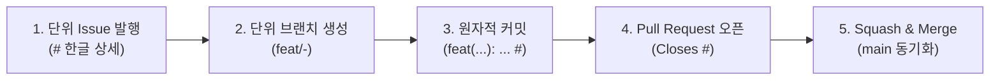

# GitHub 전체 수명주기 관리 및 원바이원(One-by-One) 규칙

## 🚨 필수 라이프사이클: 1 기능단위 = 1 이슈 = 1 브랜치 = 1 커밋 = 1 PR

본 저장소의 모든 변경사항(기능 구현, 버그 수정, 아키텍처 리팩토링, 설정 변경, 문서 작성 등)은 **기능 단위로 쪼개어 하나씩 순차적으로(One-by-One)** 아래 5단계 라이프사이클을 통과해야 합니다.

---

## 1. 이슈 기반 개발 (Issue-Driven Development)

1. **이슈 없는 변경 전면 금지**:
   - `main` 브랜치에 직접 푸시하거나, 이슈 없이 생성된 PR은 코드 리뷰 대상에서 제외됩니다.
2. **이슈 제목 및 본문 한글화 원칙**:
   - 이슈 제목: `<type>(<scope>): <한국어 요약>` (예: `feat(auth): 회원 비밀번호 변경 DTO 및 유효성 검증 정규식 정의`)
   - 이슈 본문: 사용자 스토리, 인수 조건(체크리스트), 영향받는 MSA 서비스, 보안 요구사항을 한국어로 명확히 작성합니다.
3. **기능 단위(Granular Task) 쪼개기**:
   - 거대한 기능 전체를 하나의 이슈로 등록하지 않고, 계층별/기능별 단위로 쪼개어 각각 독립된 이슈로 발행합니다.

---

## 2. 브랜치 바인딩 및 원자적 커밋

1. **브랜치 명명 규격**:
   - 반드시 이슈 번호를 접두사로 포함합니다: `<type>/<issue-number>-<slug>`
   - 예시: `feat/14-change-password-dto`, `fix/22-jwt-token-leak`
2. **Conventional Commits**:
   - 커밋 메시지에 해당 이슈 번호를 바인딩합니다: `feat(auth): add change password dto (#14)`

---

## 3. Pull Request 및 자동 머지

1. **PR 템플릿 준수**:
   - `.github/pull_request_template.md`를 기반으로 한글 요약, 세부 변경사항, 검증 체크리스트를 작성합니다.
   - PR 본문에 반드시 `Closes #<issue-id>`를 명시하여 머지 시 연관 이슈가 자동 닫히도록 설정합니다.
2. **Small PR 원칙**:
   - 코드 리뷰 품질을 위해 diff는 200줄 이내(최대 400줄)로 유지합니다.
3. **Squash and Merge**:
   - PR 승인 후 Squash and Merge 방식으로 `main`의 선형(Linear) 히스토리를 유지하고 작업 브랜치를 삭제합니다.
