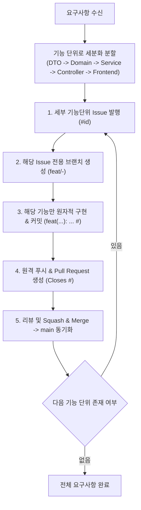

# 안티그래비티 워크스페이스 개발 가이드라인 (MSA 풀스택 프로젝트)

본 프로젝트는 실리콘밸리 빅테크 엔지니어링 표준을 준수하는 엔터프라이즈 마이크로서비스 아키텍처(MSA) 플랫폼입니다. 안티그래비티(Antigravity)는 아래 명시된 도메인 경계, 복원력 패턴, 보안 모델 및 **원바이원(One-by-One) 이슈-PR 라이프사이클**을 엄격히 준수해야 합니다.

---

## 🏛️ 시스템 아키텍처 개요

- **프론트엔드 (Frontend)**: Next.js 14/15 App Router, React Server Components (RSC), TanStack Query, Strict TypeScript, HttpOnly Cookie 기반 인증.
- **백엔드 서비스 (Backend Services)**: Java 21, Spring Boot 3.x, Spring Cloud Netflix Eureka, Spring Security (Stateless JWT).
- **서비스 간 통신 & 이벤트 (Communication & EDA)**:
  - 동기 통신: OpenFeign + Resilience4j (타임아웃, 서킷브레이커, 벌크헤드).
  - 비동기 통신: Apache Kafka + CloudEvents 1.0 규격, Transactional Outbox 패턴, Idempotent Consumer, DLT(Dead Letter Topic).
- **캐싱 & 분산 상태 (Caching & State)**: Redis (Cache-Aside, TTL Jitter, Redisson 분산 락).
- **API 문서화 (Documentation)**: Springdoc OpenAPI 3.0 / Swagger UI (글로벌 Bearer JWT 인증).
- **인프라 & CI/CD**: Docker (Distroless 멀티스테이지), Kubernetes (Actuator 프로브, Non-root 보안), GitHub Actions (Matrix 빌드, Trivy 보안 검사, GitOps).

---

## 🧭 핵심 아키텍처 및 작업 프로세스 규칙

### 🚨 [최우선 규칙] 원바이원(One-by-One) 기능 단위 라이프사이클 (Strictly Enforced)

**하나의 요구사항을 통째로 작업하지 않고, 반드시 세부 기능 단위로 쪼개어 "이슈 발행 → 브랜치 생성 → 커밋 → 푸시 → PR"을 하나씩 순차적으로(One-by-One) 완료해야 합니다.**

1. **이슈 없는 작업 전면 금지**: 모든 작업은 GitHub Issue가 선행되어야 하며, 이슈 본문 및 설명은 **한국어로 명확히 작성**합니다.
2. **원바이원 순차 실행**:
   - `Step 1`: DTO & Validation & ErrorCode 단위 작업 (이슈 생성 -> 브랜치 -> 커밋 -> PR -> 머지)
   - `Step 2`: Domain Entity & Transactional Outbox 단위 작업 (이슈 생성 -> 브랜치 -> 커밋 -> PR -> 머지)
   - `Step 3`: Service & Redis 세션 제어 단위 작업 (이슈 생성 -> 브랜치 -> 커밋 -> PR -> 머지)
   - `Step 4`: Controller & Swagger 명세 단위 작업 (이슈 생성 -> 브랜치 -> 커밋 -> PR -> 머지)
   - `Step 5`: Frontend BFF Route Handler 단위 작업 (이슈 생성 -> 브랜치 -> 커밋 -> PR -> 머지)
3. **`main` 직접 푸시 절대 금지**: 모든 변경사항은 반드시 PR을 통해서만 `main`에 병합됩니다.

---

### 1. 제로 트러스트(Zero-Trust) & 게이트웨이 인증 (재검증 생략)
- 외부 트래픽은 반드시 Spring Cloud Gateway를 통해서만 진입합니다.
- 게이트웨이가 JWT 서명 및 유효기간을 검증한 뒤 내부 신뢰 헤더(`X-User-Id`, `X-User-Roles`)를 주입합니다.
- 내부 마이크로서비스는 이 헤더를 신뢰하며, **불필요한 JWT 중복 재검증/JWKS 조회를 생략**합니다.
- **IDOR 보안 취약점 원천 차단**: 본인 정보 변경 엔드포인트는 URL에 `{userId}` `@PathVariable`을 받지 않고, `@RequestHeader("X-User-Id")`로만 사용자 식별자를 바인딩합니다.

### 2. Transactional Outbox 패턴 (Dual-Write 방지)
- DB 트랜잭션 메서드 내부에서 Kafka로 직접 이벤트를 발행하지 않습니다.
- 동일한 ACID 트랜잭션 범위 안에서 로컬 `outbox_events` 테이블에 감사 이벤트를 저장하고, Debezium CDC 또는 비동기 폴러를 통해 Kafka로 안전하게 중계합니다.

### 3. Kafka Idempotent Consumer (멱등 수신 보장)
- 모든 Kafka 컨슈머는 중복 수신을 방어해야 합니다.
- 비즈니스 로직 실행 전 `processed_events` 테이블에서 이벤트 처리 여부를 조회하고, 재시도 불가능한 에러는 Dead Letter Topic(`<topic>.DLT`)으로 격리합니다.

### 4. Redis 캐싱 & 스탬피드 방어
- 모든 Redis 키에는 반드시 명시적인 만료시간(TTL)을 부여합니다.
- 캐시 집단 만료(Thundering Herd)를 방지하기 위해 랜덤 오프셋(TTL Jitter)을 추가합니다.
- 동시성 제어가 필요한 경우 Redisson의 `RLock`을 사용하며 원시 `SETNX` 사용을 금지합니다.

### 5. Next.js App Router & BFF 패턴
- `app/` 컴포넌트는 기본적으로 React Server Component(RSC)로 작성하며, `'use client'`는 말단 인터랙션 노드로 한정합니다.
- `app/api/**/route.ts` Route Handler를 경량 BFF로 활용하여 HttpOnly 인증 쿠키 관리 및 마이크로서비스 호출을 캡슐화합니다.

---

## 📂 모듈형 세부 규칙 목록 (`.agents/rules/`)

1. [MSA 아키텍처 및 복원력 설계](.agents/rules/00-architecture-msa.md)
2. [Spring Boot 및 Java 21 클린 아키텍처](.agents/rules/01-spring-boot-java.md)
3. [Spring Security 및 게이트웨이 토큰 릴레이](.agents/rules/02-spring-security.md)
4. [Next.js App Router 및 프론트엔드 표준](.agents/rules/03-nextjs-frontend.md)
5. [이벤트 주도 아키텍처(EDA) 및 Kafka 규칙](.agents/rules/04-eda-kafka.md)
6. [Redis 캐싱 및 분산 락 동기화](.agents/rules/05-redis-caching.md)
7. [Swagger 및 OpenAPI 3.x 명세화 표준](.agents/rules/06-swagger-openapi.md)
8. [Docker 및 Kubernetes 프로덕션 배포 규격](.agents/rules/07-docker-kubernetes.md)
9. [GitHub Actions CI/CD 및 GitOps 파이프라인](.agents/rules/08-github-actions-ci-cd.md)
10. [Git 커밋 규격 및 원바이원 기능단위 원칙](.agents/rules/09-git-commit-standards.md)
11. [PR 수명주기 및 코드 리뷰 문화](.agents/rules/10-github-pr-code-review.md)
12. [GitHub 전체 라이프사이클 관리 및 MCP 연동](.agents/rules/11-github-lifecycle-management.md)
