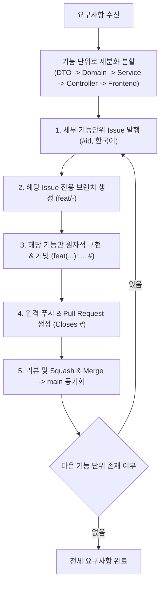

# 엔터프라이즈 MSA & 풀스택 프로젝트 에이전트 룰스 (Agent Rules)

이 저장소는 실리콘밸리 빅테크 기업의 엔지니어링 표준을 기반으로 설계된 **마이크로서비스 아키텍처(MSA) 및 풀스택 개발 규칙 모음**입니다.

Google DeepMind **Antigravity (AGY)** 및 **Cursor** AI 에이전트와 완벽히 호환되며, 모든 규칙과 작업 가이드는 **한국어**로 표준화되어 있습니다.

---

## 🚨 필수 엔지니어링 프로세스: 원바이원(One-by-One) 라이프사이클

모든 요구사항과 변경사항은 하나의 덩어리로 처리하지 않고, 반드시 **세부 기능 단위로 쪼개어 하나씩 순차적으로(One-by-One)** 완료해야 합니다:



---

## 🧭 프로젝트 구조 및 룰 체계

```text
├── GEMINI.md                          # 안티그래비티 전역 워크스페이스 진입점 및 규칙 (한국어)
├── .agents/                           # 안티그래비티 네이티브 커스터마이징 루트
│   ├── rules/                         # 모듈별 세부 엔지니어링 가이드라인 (.md)
│   │   ├── 00-architecture-msa.md     # MSA 아키텍처, DDD, Saga, Eureka, Resilience4j
│   │   ├── 01-spring-boot-java.md     # Java 21, 헥사고날 아키텍처, Record DTO, JPA
│   │   ├── 02-spring-security.md      # Stateless JWT, 게이트웨이 인증 신뢰, IDOR 방어
│   │   ├── 03-nextjs-frontend.md      # Next.js App Router, RSC, BFF, TanStack Query
│   │   ├── 04-eda-kafka.md            # CloudEvents 규격, Idempotent Consumer, Outbox
│   │   ├── 05-redis-caching.md        # Cache-Aside, Redisson 분산 락, TTL Jitter
│   │   ├── 06-swagger-openapi.md      # Springdoc OpenAPI 3.0, Bearer Auth 스키마
│   │   ├── 07-docker-kubernetes.md    # Multi-stage Distroless, K8s Actuator 프로브
│   │   ├── 08-github-actions-ci-cd.md # Matrix 빌드, Trivy 컨테이너 보안, GitOps 연동
│   │   ├── 09-git-commit-standards.md # Conventional Commits, 원바이원 기능단위 커밋
│   │   ├── 10-github-pr-code-review.md# Small PR 원칙(<400줄), Conventional Comments
│   │   └── 11-github-lifecycle-management.md # 이슈-브랜치-커밋-PR 풀사이클 관리
│   └── skills/
│       ├── msa-workflow/SKILL.md      # 안티그래비티 MSA 기능 구현 온디맨드 스킬
│       └── github-automation/SKILL.md # GitHub 이슈 생성 및 PR 자동화 스킬
├── .cursor/
│   └── rules/                         # Cursor 전용 규칙 파일 (.mdc, globs 매핑)
├── .github/
│   ├── ISSUE_TEMPLATE/                # GitHub 실무 표준 이슈 템플릿 (한국어)
│   │   ├── feature_request.md
│   │   ├── bug_report.md
│   │   ├── tech_debt.md
│   │   └── config.yml
│   └── pull_request_template.md       # GitHub 실무 PR 표준 템플릿 (한국어)
└── mcp_config.json                    # GitHub MCP Server 연동 설정
```

---

## 🔒 핵심 보안 원칙 요약
1. **게이트웨이 인증 토큰 신뢰 (중복 재검증 생략)**: 게이트웨이가 외부 JWT를 검증하고 내부 헤더(`X-User-Id`, `X-User-Roles`)를 주입하므로, 내부 서비스에서는 서명 재검증을 생략하여 지연 시간을 최소화합니다.
2. **IDOR 취약점 원천 차단**: 본인 정보 수정 API에서 URL에 `{userId}` `@PathVariable`을 받지 않고 헤더 식별자만 바인딩합니다.
3. **비밀번호 변경 시 세션 무효화**: 비밀번호 변경 즉시 Redis에 저장된 Refresh Token 및 캐시 세션을 일괄 삭제하여 기존 기기에서 강제 로그아웃 처리합니다.
